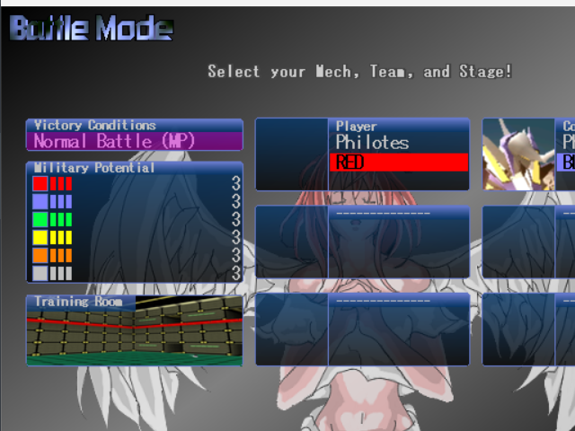
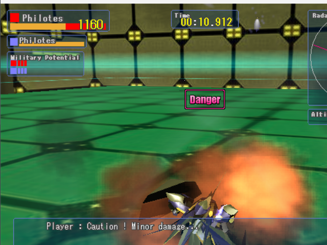

# Silver Knights — How to Play

**English** · [Português abaixo](#português)

A guide for a first-time pilot. Silver Knights is a 3D mech arena fighter: you pick a machine,
pick a battlefield, and fight one-on-one or in teams. It is from 2003–2012, so it is *direct*
about difficulty — nothing is explained in-game and the tutorial mode does not exist. This
document is the manual the game never shipped.

> New here and the game will not start? Read **[SETUP-WINDOWS.md](SETUP-WINDOWS.md)** first.

---

## 1. Getting into a match

Launch `SK-Startup.exe`, click **Window**, and wait for the title screen. Press any key, then you
get the main menu:

```
  Story Mode
  Battle Mode
  Network Mode
  Replay
  Option
```

For a first game choose **Battle Mode**.

On the setup screen there are three things to set, and this is where most people get stuck:



| Panel | What it does |
|---|---|
| **Victory Conditions** | How the match is won. `Normal Battle (MP)` = reduce the enemy's Military Potential to zero |
| **Military Potential** | The six coloured bars. Each is a resource pool for a weight class. `3` each is a fair default |
| **Stage** | The map. `Training Room` is the flat, walled arena — the best place to learn |

Then press **F3** to start.

**Enter does not start the match.** On this screen Enter only moves the cursor between slots.
The match begins with **F3**, which is listed in `1041.ini` as `F3_START`. This single detail
costs every new player several minutes.

You will see `Battle Start`, then the countdown, then you are in.

---

## 2. Reading the screen

```
┌──────────────────────────────────────────────────────────────┐
│ [your mech]   Time: 00:10.912        Radar        Altitude    │
│  Philotes                                                     │
│  ████████ 1160        Military Potential                      │
│  ██ ██ ██ ██ ██ ██                                            │
│                                                               │
│                        ┌──────────┐                           │
│                        │  Danger  │   ← incoming fire        │
│                        └──────────┘                           │
│                                       [enemy] Philotes       │
│                     your mech, third-person                   │
└──────────────────────────────────────────────────────────────┘
```



*A real match, timer at `00:10.912`. The `Danger` box means incoming fire, and
`Caution ! Minor damage...` is the game's own damage message. The mech is mid-explosion.*

| Element | Meaning |
|---|---|
| **Top-left bar + number** | Your armour. When it empties, you are out |
| **Military Potential** | Your team's remaining resources. This is the actual win condition — not kills |
| **Time** | Match clock. Battles are capped at **30 minutes**; see §7 |
| **Radar** (top right) | Enemy positions relative to you. Watch this more than you think |
| **Altitude** (top right) | How high you are. Falling off the map is a real way to lose |
| **Danger** | You are being shot at *right now*. Move |
| **Enemy panel** | Their armour and name |

A message strip appears at the bottom-left during play — `Caution ! Minor damage...` and similar.
These are the game talking to you. There is no pause to read them.

---

## 3. Controls

Keyboard defaults, from `SilverKnights.ini` `[KEYBOARD]`. The game was designed for an 8-button
gamepad, so a keyboard is a compromise — but it works.

| Key | Action |
|---|---|
| **Arrow keys** | Move and turn |
| **B** | Main shooting / sword attack |
| **V** | Sub shooting / heavy sword attack |
| **C** | Flight / boost |
| **X** | Guard |
| **Z** | Option / modification |
| **N** | Lock-on |
| **F** | Help message |
| **D** | Spare message |
| **F3** | Start the match |
| **ESC** | Back / cancel |

Three modifiers worth memorising:

- **Press a direction twice** → dash. This is the single most useful movement skill.
- **Press `C` twice** → sudden vertical rise. Emergency escape.
- **Press `N` twice** → cancel lock-on.

---

## 4. The three movement modes

This is the part that makes Silver Knights different from a normal shooter. Your mech has three
distinct ways of moving, and the controls *change meaning* between them.

### Ground
Your mech walks and turns. With lock-off, left/right **turns** you. With lock-on, left/right
**strafes** around the target. This is the mode where you learn to aim.

### Space
Left/right becomes full directional movement. Add **C** with a direction and you move
up/down/sideways. **C alone** moves you forward. This is how you fight in open air, and it is
where the game becomes fun.

### Flight
Your mech becomes an aircraft. Up/down pitches, left/right turns, **C** accelerates. `X` and `Z`
become **right yaw** and **left yaw** — they stop being Guard and Option. Pressing `X` + `Z`
together cancels a modification.

> The mode change is the thing to practise first. Flying into a wall because you pressed `X`
> expecting to guard, but you were in Flight mode, is a rite of passage.

### Watch mode
A spectator/replay mode. `V` rewinds, `C` changes mode, `X`/`Z` move the camera sideways.

---

## 5. Lock-on, and why it matters

Press **N** to lock onto the enemy in front of you. The HUD marks the target.

While locked:
- Left/right **strafes** instead of turning — you circle the target
- **N + left/right** changes which target is locked
- **N twice** cancels

Lock-on is not a convenience, it is a different control scheme. Strafing around a locked target
while firing is the core combat loop. Fighting unlocked is much harder, so lock on early and
stay locked.

---

## 6. Practical first-match advice

1. **Pick Training Room.** Flat, walled, no ledges to fall off.
2. **Lock on immediately** with `N`, then keep the target circled.
3. **Guard is `X`, and it works.** New players forget it exists. Most incoming fire is survivable
   if you are guarding.
4. **Dash constantly.** Double-tap a direction. Standing still is how you die.
5. **Watch the Military Potential bars, not your kill count.** You win by draining their
   resources, which is not the same as destroying one mech.
6. **Learn one mode at a time.** Stay on the ground for your first match. Add Space once you can
   move without thinking.
7. **The `Danger` warning is real.** When it appears you are already being hit. Move first,
   look second.

---

## 7. The 30-minute limit

A battle ends itself at exactly **30 minutes**, cleanly, with no error. This is a **designed
session cap**, not a crash or a bug — verified against the game's own log, which writes an
ordinary `End` line at 1800 seconds and exits with status 0.

It applies to **matches only**. Sitting in the menus is not capped; a 31-minute idle in the main
menu was tested and the process survived.

So: if the game closes after half an hour of fighting, that is the cap. Start another match. You
do not need to restart the whole game.

---

## 8. Customising

### Emblem
Replace `emblem.bmp` (64×64, fixed size). Pure black `(0,0,0)` becomes transparent. Your emblem
is shown to opponents in network play, and on the results screen.

### Graphics and sound
`SilverKnights.ini` under `[ENVIRONMENT]`. The interesting keys:

| Key | Effect |
|---|---|
| `RESOLUTION` | Resolution preset. `4` was 1280×960 in testing |
| `EFFECT_LEVEL` | `1` = lowest (the shipped default), `3` = highest post-processing |
| `HDR_LIGHTING` | `1` enables HDR |
| `DEPTH_OF_FIELD` | `1` enables DoF |
| `MOTION_BLUR` | `1` enables motion blur |
| `OUTLINE` | `1` enables the cel-shading outline |
| `BGM_VOLUME` | 0–1000 |
| `MIDI` | `1` = use `midi/*.mid`, `0` = use `mp3/*.mp3` |

Back the file up before editing. The highest settings were verified to run without errors on
modern hardware, but they are heavier than the 2012 default and older GPUs may struggle.

### Language
The game reads your OS language code and loads `<code>.ini`. Only `1041.ini` (Japanese) ships.
To get an English UI, you would need to obtain or write a `1033.ini` — the ReadMe explains the
format. There is no English language file in the distributed release.

---

## 9. What is not working

Be aware before you invest time:

| Area | State |
|---|---|
| Network / multiplayer | **Untested.** The lobby needs a player name typed by hand; it could not be automated, so nobody has confirmed whether DirectPlay still initialises on modern Windows |
| Controller / joystick | **Untested.** No device was available. The game expects 8+ buttons |
| Story Mode | **Not verified.** Battle Mode is the verified path |
| Replay recording | **Not verified.** `F2` toggles record, but no `.rep` file appeared in testing |

If you get multiplayer or a controller working, that is genuinely new information — it is the
largest remaining unknown in this project.

---

## 10. Quick reference

```
START MATCH ........ F3   (not Enter)
LOCK ON ............ N    (twice = cancel)
MOVE / TURN ........ arrows
DASH ............... double-tap a direction
MAIN ATTACK ........ B
HEAVY ATTACK ....... V
GUARD .............. X
FLIGHT / BOOST ..... C    (twice = sudden rise)
OPTION ............. Z
BACK ............... ESC
```

---
---

# Português

Um guia para quem vai pilotar pela primeira vez. Silver Knights é um jogo de arena 3D com mechs:
você escolhe uma máquina, escolhe um campo de batalha e luta um-contra-um ou em times. É de
2003–2012, então é *direto* quanto à dificuldade — nada é explicado dentro do jogo e o modo
tutorial não existe. Este documento é o manual que o jogo nunca teve.

> Chegou agora e o jogo não abre? Leia primeiro o **[SETUP-WINDOWS.md](SETUP-WINDOWS.md)**.

---

## 1. Entrando em uma partida

Abra `SK-Startup.exe`, clique em **Window** e espere a tela de título. Aperte qualquer tecla e
você chega ao menu principal:

```
  Story Mode
  Battle Mode
  Network Mode
  Replay
  Option
```

Para o primeiro jogo escolha **Battle Mode**.

Na tela de configuração há três coisas para ajustar, e é aqui que quase todo mundo trava:

| Painel | O que faz |
|---|---|
| **Victory Conditions** | Como se vence. `Normal Battle (MP)` = zerar o Military Potential do inimigo |
| **Military Potential** | As seis barras coloridas. Cada uma é uma reserva de recursos por classe. `3` em todas é um padrão justo |
| **Stage** | O mapa. `Training Room` é a arena plana com paredes — o melhor lugar para aprender |

Depois aperte **F3** para começar.

**Enter não inicia a partida.** Nessa tela o Enter só move o cursor entre os slots. A partida
começa com **F3**, que está listado no `1041.ini` como `F3_START`. Esse único detalhe custa
vários minutos a todo jogador novo.

Você verá `Battle Start`, depois a contagem, e está dentro.

---

## 2. Lendo a tela

```
┌──────────────────────────────────────────────────────────────┐
│ [seu mech]    Time: 00:10.912        Radar       Altitude     │
│  Philotes                                                     │
│  ████████ 1160        Military Potential                      │
│  ██ ██ ██ ██ ██ ██                                            │
│                                                               │
│                        ┌──────────┐                           │
│                        │  Danger  │   ← tiros chegando       │
│                        └──────────┘                           │
│                                       [inimigo] Philotes      │
│                     seu mech, em terceira pessoa              │
└──────────────────────────────────────────────────────────────┘
```

| Elemento | Significado |
|---|---|
| **Barra e número no topo esquerdo** | Sua armadura. Se zerar, você está fora |
| **Military Potential** | Os recursos restantes do seu time. É a condição de vitória de verdade — não abates |
| **Time** | Relógio da partida. Batalhas têm teto de **30 minutos**; veja §7 |
| **Radar** (topo direito) | Posição dos inimigos em relação a você. Olhe mais do que imagina |
| **Altitude** (topo direito) | Sua altura. Cair do mapa é uma forma real de perder |
| **Danger** | Você está sendo atingido *agora*. Mova-se |
| **Painel do inimigo** | Armadura e nome deles |

Uma faixa de mensagens aparece no canto inferior esquerdo durante o jogo —
`Caution ! Minor damage...` e outras. É o jogo falando com você. Não há pausa para ler.

---

## 3. Controles

Padrões de teclado, do `SilverKnights.ini` seção `[KEYBOARD]`. O jogo foi feito para um gamepad
de 8 botões, então teclado é um compromisso — mas funciona.

| Tecla | Ação |
|---|---|
| **Setas** | Mover e virar |
| **B** | Tiro principal / golpe de espada |
| **V** | Tiro secundário / golpe pesado |
| **C** | Voo / impulso |
| **X** | Defesa |
| **Z** | Opção / modificação |
| **N** | Travar alvo |
| **F** | Mensagem de ajuda |
| **D** | Mensagem extra |
| **F3** | Iniciar a partida |
| **ESC** | Voltar / cancelar |

Três modificadores que valem decorar:

- **Aperte uma direção duas vezes** → dash. É a habilidade de movimento mais útil.
- **Aperte `C` duas vezes** → subida vertical súbita. Fuga de emergência.
- **Aperte `N` duas vezes** → cancela a trava de alvo.

---

## 4. Os três modos de movimento

Esta é a parte que faz Silver Knights ser diferente de um shooter comum. Seu mech tem três
formas distintas de se mover, e os controles *mudam de significado* entre elas.

### Solo (Ground)
Seu mech anda e vira. Sem trava, esquerda/direita **gira**. Com trava, esquerda/direita faz
**strafe** ao redor do alvo. É o modo onde você aprende a mirar.

### Espaço (Space)
Esquerda/direita passa a ser movimento direcional completo. Some **C** com uma direção e você se
move para cima/baixo/lado. **C sozinho** move para frente. É como se luta em céu aberto, e é onde
o jogo fica divertido.

### Voo (Flight)
Seu mech vira um avião. Cima/baixo inclina, esquerda/direita vira, **C** acelera. `X` e `Z`
passam a ser **guinada à direita** e **guinada à esquerda** — deixam de ser Defesa e Opção.
Apertar `X` + `Z` juntos cancela uma modificação.

> A troca de modo é o que se deve praticar primeiro. Voar contra uma parede porque você apertou
> `X` esperando defender, mas estava em modo Voo, é um rito de passagem.

### Modo assistir (Watch)
Modo espectador/replay. `V` volta, `C` troca de modo, `X`/`Z` movem a câmera para os lados.

---

## 5. Trava de alvo, e por que importa

Aperte **N** para travar no inimigo à sua frente. O HUD marca o alvo.

Com a trava ativa:
- Esquerda/direita faz **strafe** em vez de girar — você circula o alvo
- **N + esquerda/direita** troca qual alvo está travado
- **N duas vezes** cancela

A trava não é uma conveniência, é um esquema de controle diferente. Circular um alvo travado
enquanto atira é o laço central de combate. Lutar sem trava é bem mais difícil, então trave cedo
e fique travado.

---

## 6. Conselhos práticos para a primeira partida

1. **Escolha Training Room.** Plana, com paredes, sem beiradas para cair.
2. **Trave o alvo imediatamente** com `N`, e mantenha o alvo circulando.
3. **Defesa é `X`, e funciona.** Jogadores novos esquecem que existe. A maioria dos tiros é
   sobrevivível se você estiver defendendo.
4. **Dê dash o tempo todo.** Toque duas vezes numa direção. Ficar parado é como se morre.
5. **Olhe as barras de Military Potential, não seu número de abates.** Você vence drenando os
   recursos deles, o que não é a mesma coisa que destruir um mech.
6. **Aprenda um modo por vez.** Fique no solo na primeira partida. Adicione o Espaço quando
   conseguir se mover sem pensar.
7. **O aviso `Danger` é real.** Quando aparece você já está sendo atingido. Mova primeiro, olhe
   depois.

---

## 7. O limite de 30 minutos

Uma batalha se encerra sozinha em exatamente **30 minutos**, de forma limpa, sem erro. É um
**teto de sessão planejado**, não um travamento nem um bug — verificado contra o log do próprio
jogo, que escreve uma linha `End` normal aos 1800 segundos e sai com status 0.

Vale **só para partidas**. Ficar nos menus não tem limite; testamos 31 minutos parado no menu
principal e o processo sobreviveu.

Então: se o jogo fechar depois de meia hora de luta, é o teto. Comece outra partida. Você não
precisa reiniciar o jogo inteiro.

---

## 8. Personalizando

### Emblema
Substitua `emblem.bmp` (64×64, tamanho fixo). Preto puro `(0,0,0)` fica transparente. Seu emblema
é mostrado aos oponentes no modo rede, e na tela de resultados.

### Gráficos e som
`SilverKnights.ini`, seção `[ENVIRONMENT]`. As chaves interessantes:

| Chave | Efeito |
|---|---|
| `RESOLUTION` | Preset de resolução. `4` era 1280×960 nos testes |
| `EFFECT_LEVEL` | `1` = mais baixo (o padrão distribuído), `3` = pós-processamento máximo |
| `HDR_LIGHTING` | `1` ativa HDR |
| `DEPTH_OF_FIELD` | `1` ativa profundidade de campo |
| `MOTION_BLUR` | `1` ativa desfoque de movimento |
| `OUTLINE` | `1` ativa o contorno de cel-shading |
| `BGM_VOLUME` | 0–1000 |
| `MIDI` | `1` = usar `midi/*.mid`, `0` = usar `mp3/*.mp3` |

Faça backup do arquivo antes de editar. As configurações máximas foram verificadas rodando sem
erros em hardware moderno, mas são mais pesadas que o padrão de 2012 e GPUs antigas podem sofrer.

### Idioma
O jogo lê o código de idioma do seu sistema e carrega `<código>.ini`. Só o `1041.ini` (japonês)
vem junto. Para ter a interface em inglês seria preciso obter ou escrever um `1033.ini` — o
ReadMe explica o formato. Não existe arquivo de idioma inglês na distribuição original.

---

## 9. O que não está funcionando

Saiba antes de investir tempo:

| Área | Estado |
|---|---|
| Rede / multiplayer | **Não testado.** O lobby exige um nome digitado à mão; não foi possível automatizar, então ninguém confirmou se o DirectPlay ainda inicializa no Windows moderno |
| Controle / joystick | **Não testado.** Não havia dispositivo disponível. O jogo espera 8+ botões |
| Story Mode | **Não verificado.** Battle Mode é o caminho verificado |
| Gravação de replay | **Não verificado.** `F2` alterna a gravação, mas nenhum arquivo `.rep` apareceu nos testes |

Se você conseguir fazer o multiplayer ou um controle funcionar, isso é informação genuinamente
nova — é a maior incógnita restante neste projeto.

---

## 10. Referência rápida

```
INICIAR PARTIDA .... F3   (não é Enter)
TRAVAR ALVO ........ N    (duas vezes = cancelar)
MOVER / VIRAR ...... setas
DASH ............... aperte uma direção duas vezes
ATAQUE PRINCIPAL ... B
ATAQUE PESADO ...... V
DEFESA ............. X
VOO / IMPULSO ...... C    (duas vezes = subida súbita)
OPÇÃO .............. Z
VOLTAR ............. ESC
```
